# Panopticon

Panopticon captures interactions with simulated SSH service, stores them as structured events and lets an operator inspect live and historical activity.

## Current collection architecture

```mermaid
flowchart LR
    Honeypot[SSH honeypot] --> Handler[Event collector]
    Handler --> Queue[Bounded in-memory queue]
    Queue --> Writer[Background writer]
    Writer --> Store[EventStore interface]
    Store --> SQLite[SQLiteEventStore]
    SQLite --> DB[(SQLite database)]
    DB -. Planned historical queries .-> API[FastAPI service]
    API -. Planned responses .-> UI[React dashboard]
```

The collector depends on a small storage protocol. SQLite owns schema creation, parameterised inserts and indexes. Blocking storage operations run in a background thread, and the SSH service shares one collector across connections. FastAPI, React and the controller remain planned.

### Services
| Service          | Purpose                                                                                                      |
|------------------|--------------------------------------------------------------------------------------------------------------|
| Controller       | Start and stop configured honeypots and reconcile their desired and actual states.                           |
| Event collector | Queue event snapshots and commit them through an injected store; drain writes during graceful shutdown. |
| API              | Provide filtered historical queries and stream live events to dashboard clients.                             |
| Frontend         | Display events, filters, and connection status.                                                              |
| SSH Honeypot     | Simulate SSH interactions and produce connection, authentication, and command events.                        |

## API
### Endpoints
`GET /events` -- Shows a list of events in a newest-first order

| Parameter  | Type      | Proposed Behaviour                                           |
| ---------- | --------- | ------------------------------------------------------------ |
| limit      | int       | Default `50`, minimum `1`, maximum `500`.                    |
| event_type | EventType | One of the supported event types. Invalid values return 422. |
| src_ip     | string    | Exact IPv4 address match.                                    |
| src_port   | int       | Exact source-port match, from `0` to `65535`.                |
| session_id | string    | Exact session ID match.                                      |
| start_time | datetime  | Include events at or after this timestamp                    |
| end_time   | datetime  | Include events before this timestamp.                        |

`GET /events/stream` -- Live events stream using Server-Sent Events.

## Reliability

- Event IDs remain stable when the same event is replayed.
- SQLite commits each event transaction before the collector marks its queued write complete.
- Reprocessing an existing event ID does not duplicate or replace the stored event.
- WAL journalling allows readers alongside the single writer; full synchronisation is requested for commits.
- The SSH listener starts only after database initialisation succeeds.
- Graceful shutdown closes active SSH connections before draining the collector.
- Queue overflow is logged and raised to the publisher. A writer failure propagates to the service and stops collection.
- The bounded queue is not durable. Uncommitted events can be lost after an abrupt process crash or storage failure; there is no automatic retry or dead-letter store.

## Stack

**Backend:**
- Python sqlite3 for persistent event storage, without an external database service
- Pydantic for event validation and serialisation
- AsyncIO with blocking storage work delegated to a thread
- AsyncSSH for the asynchronous SSH server
- FastAPI planned for historical queries and dashboard access

**Frontend:**
- React dashboard planned
