# Panopticon

Panopticon captures interactions with simulated SSH service, stores them as structured events and lets an operator inspect live and historical activity.

## Current collection architecture

```mermaid
flowchart LR
    Honeypot[SSH honeypot] --> Handler[Event collector]
    Handler --> Queue[Bounded in-memory queue]
    Queue --> Writer[Background writer]
    Writer --> Store[EventStore interface]
    Store --> SQLite[SQLiteEventStore]
    SQLite --> DB[(SQLite database)]
    DB -- Read-only queries and committed event polling --> API[FastAPI service]
    API -- REST and SSE --> UI[Planned React dashboard]
```

The collector depends on a small storage protocol. SQLite owns schema creation, parameterised inserts and indexes. Blocking storage operations run in a background thread, and the SSH service shares one collector across connections. FastAPI runs as a separate service; React and the controller remain planned.

### Services
| Service          | Purpose                                                                                                      |
|------------------|--------------------------------------------------------------------------------------------------------------|
| Controller       | Start and stop configured honeypots and reconcile their desired and actual states.                           |
| Event collector | Queue event snapshots and commit them through an injected store; drain writes during graceful shutdown. |
| API              | Provide filtered historical queries and stream live events to dashboard clients.                             |
| Frontend         | Display events, filters, and connection status.                                                              |
| SSH Honeypot     | Simulate SSH interactions and produce connection, authentication, and command events.                        |

## API

The independently runnable FastAPI service provides event history/detail, session summaries, dashboard totals, activity timelines and ranked source/credential/command values. `/events/stream` supplies SSE from committed database rows with event UUID resume cursors and idle keepalives. See README.md and the generated `/docs` for endpoint contracts and filter limits.

API routes depend on an `EventReader` protocol. `SQLiteEventReader` supplies parameterised, read-only queries using operation-scoped connections. Both services initialise the same schema on startup, share the SQLite volume, and remain independently runnable. Redis is not required.

The Dockerfile has shared runtime dependencies with separate `ssh` and `api` targets. Compose starts one container per service; API ports are published on loopback. The API is currently intended for local operator access and has no authentication.

## Reliability

- Event IDs remain stable when the same event is replayed.
- SQLite commits each event transaction before the collector marks its queued write complete.
- Reprocessing an existing event ID does not duplicate or replace the stored event.
- WAL journalling allows readers alongside the single writer; full synchronisation is requested for commits.
- The SSH listener starts only after database initialisation succeeds.
- Graceful shutdown closes active SSH connections before draining the collector.
- Queue overflow is logged and raised to the publisher. A writer failure propagates to the service and stops collection.
- SSE reads insertion order and resumes from committed event UUIDs, independently of event timestamps. History pages return a snapshot cursor for a gapless handoff to the live stream.
- The bounded queue is not durable. Uncommitted events can be lost after an abrupt process crash or storage failure; there is no automatic retry or dead-letter store.

## Stack

**Backend:**
- Python sqlite3 for persistent event storage, without an external database service
- Pydantic for event validation and serialisation
- AsyncIO with blocking storage work delegated to a thread
- AsyncSSH for the asynchronous SSH server
- FastAPI and Uvicorn for historical queries, statistics and SSE

**Frontend:**
- React dashboard planned
